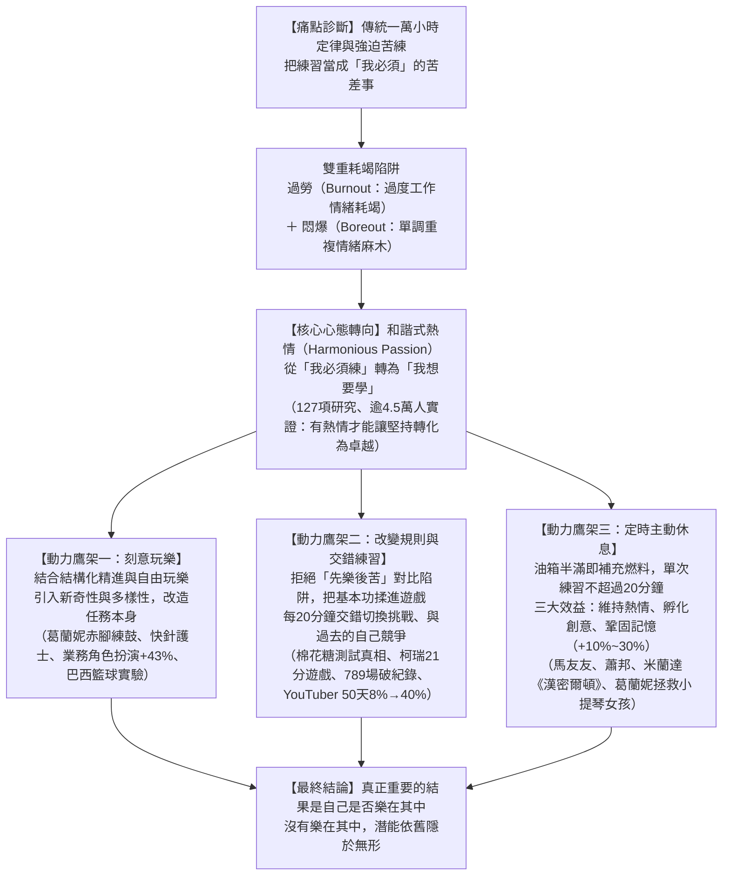
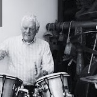
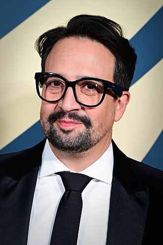
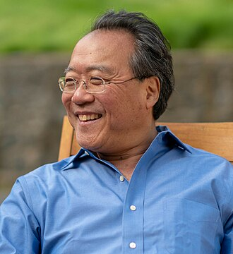
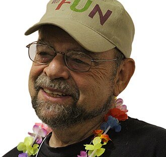
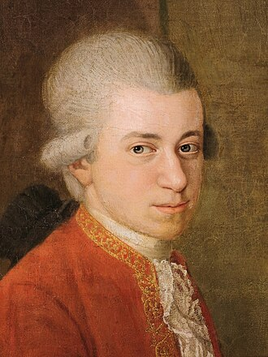
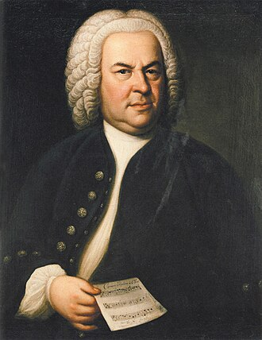
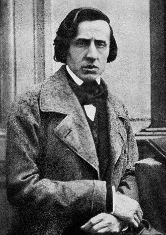
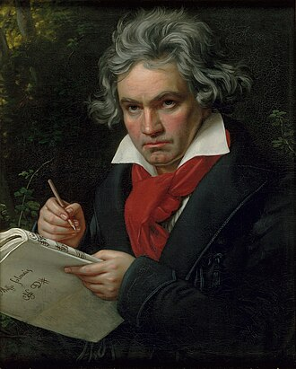
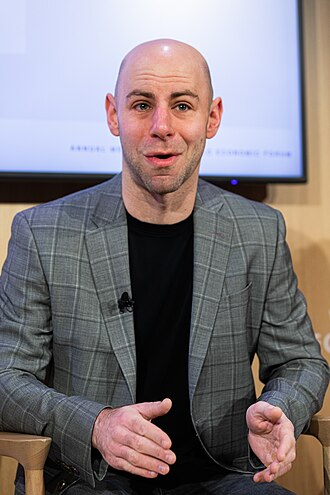

# CH4 改變日常磨練——為練習注入熱情

> **題辭**：「滿足我們的，既不是工作，也不是玩樂；既不是目的，也不是漫無目的，而是中間的反覆橫跳。」——遊戲設計師伯納德・德科文（Bernard De Koven）（p.146）

> **說明**：本筆記嚴格依據《隱性潛能》第四章紙本掃描檔（p.146–p.174，共 15 張跨頁）完整整理，零外加推測。

---

## 一、一句話核心主張（本章到底在解決什麼問題？）

**釋放隱性潛能的最好方法，並不是靠意志力忍受每天單調的磨練，而是透過「刻意玩樂（Deliberate Play）、交錯練習（Interleaving）與定時休息（Scheduled Rest）」搭建動力鷹架，把每天的苦練轉變成日常的快樂泉源（和諧式熱情）。**（p.149–150）

---

## 二、全章邏輯骨架與結構圖

---

## 三、逐節重點完整拆解（依原書章節順序）

### 0. 開場案例：失聰打擊樂女王依芙琳・葛蘭妮（Evelyn Glennie）（p.146–p.150）

- **本節要解決的問題／核心論點**：當先天或後天條件嚴重受限、傳統單調訓練完全行不通時，如何透過「改變學習方式」與「注入玩樂鷹架」釋放驚人潛能？
- **3 個最值得記住的亮點**：
  1. **從被判「毫無希望」到全球第一人**：蘇格蘭農場長大的少女葛蘭妮，8 歲開始喪失聽力，12 歲因神經退化**完全失聰**。她報考全英國最負盛名的倫敦皇家音樂學院（艾爾頓・強與安妮・藍妮克絲母校），在 20 分鐘面試中演奏定音鼓《威廉・泰爾序曲》、小鼓、木琴與莫札特鋼琴奏鳴曲，卻遭評審拒絕並斷言「毫無希望成為職業音樂家」。然而**不到 10 年後**，她成為**全球第一位全職獨奏打擊樂家**，每年在世界各地舉辦 **100 場**門票售罄的音樂會，贏得 **3 座葛萊美獎**（最佳古典器樂獨奏、最佳室內樂演奏、最佳跨界古典專輯），獲英國女王冊封女爵士，並於 2015 年成為首位獲得「音樂界諾貝爾獎」極地音樂獎（Polar Music Prize）的打擊樂家。
  2. **把身體變成一隻巨大的耳朵（赤腳感受震動）**：學校打擊樂老師**羅恩・福布斯（Ron Forbes）**沒有強迫她做枯燥的音階練習，而是與她一起搭建享受學習的**鷹架（Scaffolding）**。當羅恩敲擊定音鼓時，她把手放在牆上，將音高與身體部位連結（高音對應臉部與頸部，低音對應腿部與腳掌），並開始**赤腳練習**以更強烈地感受地板與樂器的震動。
  3. **如電玩升級般的挑戰**：「玩樂與努力之間從來沒有區別，我就像海綿一樣。」羅恩在小鼓上不斷縮小音高差距，讓她像**在電玩遊戲裡升級**般用指尖分辨細微差異；還常給她新挑戰：「看到這首巴哈的曲子嗎？妳覺得可以用小鼓演奏嗎？」促使她發展出詮釋巴哈的當代鼓樂風格。
- **一句話總結**：釋放隱性潛能的最好方法，並不是忍受每天的磨練，而是把每天的磨練轉變成日常的快樂泉源——在音樂中，「演奏」一詞就是 `play`（玩樂）並非巧合。

---

### 1. 第一節：進入和諧狀態（Entering a State of Harmony）（p.150–p.153）

- **本節要解決的問題／核心論點**：為什麼盲目崇拜「一萬小時定律」與強迫式刻意練習會導致身心崩潰？頂尖專家究竟靠什麼動力維持長期精進？
- **3 個最值得記住的亮點**：
  1. **莫札特的真相與「過勞 × 悶爆」雙重耗竭**：刻意練習最適用於動作一致且可預測的項目（如高爾夫揮桿、魔術方塊、小提琴），但強迫苦練代價極高。莫札特童年承受父親「毫無保留的奴役」，十幾歲時曾寫道因創作太多宣敘調而手指疼痛，近 30 歲時感嘆「好累⋯⋯演出太多了」——**莫札特之所以成功，並不是「因為」強迫練習，而是因為他「熬過了」強迫練習的折磨**（p.151）。研究顯示，強迫型工作者工時雖長，表現卻沒有比同儕好，反而同時遭受**過勞（Burnout，過度工作造成的情緒耗竭）**與**悶爆（Boreout，刺激不足、單調重複造成的情緒麻木）**。
  2. **世界級音樂會鋼琴家的童年真相（Lauren Sosniak 研究）**：心理學家勞倫・索斯尼亞克針對 **40 歲以下國際知名音樂會鋼琴家**的研究發現，他們極少患有強迫練習症候群——**年幼時大多數人每天只練習 1 小時**，也沒有虎爸虎媽逼迫，而是父母熱情回應其內在動機；到了青春期他們才穩定增加每日練習時間，原因是「他們有興趣，而且喜歡跟老師一起學習」（p.151–152）。
  3. **和諧式熱情（Harmonious Passion）與 127 項研究實證**：頂尖專家受「和諧式熱情」（享受過程本身：「我想要學」、「練習讓我興奮」）驅動，而非「強迫式熱情」（「我應該學」的壓力）。原注 47（p.155，Nancy Rothbard 研究）指出，長工時只有在強迫症驅使下才會導致憂鬱、睡眠問題、高血壓與高膽固醇，和諧式熱情則不會，且更容易進入**心流（Flow）**。一項涵蓋 **127 項研究、超過 45,000 人**的後設分析證實：有了熱情，堅持到底才更有可能帶來更佳表現（p.152）。
  - *原書插畫（p.153，Liz Fosslien 繪）*：兩條通往 `100%` 的進度條——上方標註 `「我必須」`（小人垂頭喪氣走直線），下方標註 `「我想要」`（小人歡欣鼓舞走高低起伏的曲線抵達 100%）。
- **一句話總結**：把「我必須練」的強迫壓力轉化為「我想要學」的和諧式熱情，讓練習豐富我們的生活，而不是主宰我們的生活。

---

### 2. 第二節：樂在玩樂（Deliberate Play）（p.154–p.159）

- **本節要解決的問題／核心論點**：如何具體搭建鷹架，將和諧式熱情注入枯燥的日常練習與高壓工作中？「刻意玩樂」與一般「遊戲化」有何本質差異？
- **3 個最值得記住的亮點**：
  1. **刻意玩樂（Deliberate Play）的定義與跨領域實證（銷售提升 43%）**：刻意玩樂是一種「旨在使技能發展變得令人愉快的結構化活動」，融合了**刻意練習**（拆解複雜任務、精進特定技能）與**自由玩樂**（享受樂趣）的元素，在學習的方法、工具、目標和人員中引入**新奇性與多樣性**（p.154）。
     - **醫療減壓**：作者與同事在醫療保健業實驗發現，高壓任務注入刻意玩樂能減少過勞。一位**「快針護士」**讓打針的孩子幫她計時，看能否打破她上次打針的最快紀錄，孩子立刻放鬆，下次看診還指定找她（p.155）。
     - **醫學院即興劇**：學生玩「外國電影」練習（一人大喊胡言亂語，搭檔解讀手勢與表情），顯著提升了醫師辨識病患主要症狀與展現同理心的能力（p.156）。
     - **業務角色扮演實驗**：顧客抱著一個盒子且態度冷淡，業務員必須不斷提問「盒子裡有什麼」，目標是維持 **3 分鐘不間斷的對話**。次月推銷職棒門票時，**角色扮演組比對照組多賣出 43% 的門票**，且更喜歡這門課（p.156）。
  2. **巴西青少年籃球實驗（75% 刻意玩樂 vs. 50% 刻意練習）**：為驗證「過早專業化導致運動員太早達到顛峰並倦怠」，研究人員將巴西青少年籃球員分為兩組：
     - **刻意練習組**：超過 **50%** 時間花在有無防守者的運球、傳球、投籃基本功訓練，並由教練頻繁提供回饋。
     - **刻意玩樂組**：約 **75%** 時間投入教練設計的變體規則遊戲（例如：搭檔只能傳球不能投籃；或 1 打 2、3 打 4 以少打多）。
     - **結果**：數月後測試「籃球智商與創造力」（跑向空檔、傳球擺脫防守），**刻意玩樂組顯著提升，刻意練習組卻毫無進步**（p.157–158）。
     - *原書插畫（p.158 圓餅圖）*：`沒有玩樂的練習` 五大後果——①暗暗痛恨教練（最大塊）、②偽裝受傷以逃避下次練習、③破壞器具讓任何人都無法做下次訓練、④躲在洗手間、⑤同時感到過勞及悶爆。
  3. **刻意玩樂 vs. 表面遊戲化（Gamification）——跑步機的暗黑歷史**：遊戲化（如積分、排行榜）只是為無聊任務添加華麗元素以換取短暫多巴胺，**無法讓你愛上本來就討厭的日常活動**。原注 49（p.159）揭露：**跑步機（Treadmill）最初是 19 世紀初英國監獄發明的懲罰工具**，囚犯每天在巨輪上踩踏 6 小時；當時一位獄卒寫道，令囚犯恐懼的不是「殘酷的刑罰」，而是「單調的穩定性」。相反地，**刻意玩樂是重新設計任務本身**，使其兼具激勵性與發展性。
- **一句話總結**：不要在監獄跑步機上貼積分排行榜（表面遊戲化），而是透過新奇規則重新設計任務本身（刻意玩樂），讓精進技能與享受樂趣合而為一。

---

### 3. 第三節：在練習中玩樂／改變遊戲規則／對練習的熱愛（Brandon Payne & Stephen Curry）（p.160–p.167）

- **本節要解決的問題／核心論點**：對於天生枯燥卻不可或缺的基本功（如體能衝刺、步法訓練），能否用「先玩樂、後苦練」來調劑？如果不行，該如何徹底改造規則？
- **3 個最值得記住的亮點**：
  1. **「先樂後苦」的反效果——南韓業務研究與抄寫電話簿實驗（p.161）**：作者與申智海（Jihae Shin）研究南韓零售銷售員發現，**員工越喜歡自己最愛的任務，在討厭的任務上表現就越差**。在另一項隨機對照實驗中，兩組受試者負責抄寫電話簿姓名與號碼，其中一組在抄寫前先看搞笑 YouTube 影片，結果**先看搞笑影片的組別在抄寫時犯了更多錯誤**——因為兩項任務的強烈對比，讓抄寫顯得更加無聊！這證明不能把有趣活動與無聊練習分開交替，必須把和諧式熱情融入練習的「每一個元素」。
  2. **棉花糖測試的真相與柯瑞「21分遊戲」（p.162–165）**：
     - 心理學家安傑拉・達克沃斯（Angela Duckworth）研究發現：**最自律的人其實最不需要動用意志力**，因為他們會主動改變情境。重看經典「棉花糖測試」影片發現，成功等待第二顆棉花糖的 4 歲孩子並非靠意志力硬撐，而是自建**刻意玩樂鷹架**——遮住眼睛、坐在手上，或把棉花糖揉成球當玩具彈跳（原注 50 補充：等待行為也反映孩子所處環境的穩定度與社會支持信任感）。
     - 教練**布蘭登・佩恩（Brandon Payne）**將此原理用於改造**史蒂芬・柯瑞（Stephen Curry）**的訓練。柯瑞身高 **188 公分**、體重 **84 公斤**，早年被球探看扁（「缺乏爆發力與橫向速度，絕不可能成為聯盟球星」），卻擁有出色的「海綿品格」（高中時一場糟糕的夏季聯賽中把球扔上看台、漏接、投籃不進，卻從不生悶氣或怪罪裁判隊友，仍在場邊為隊友歡呼）。
     - 佩恩為柯瑞設計**「21分遊戲」（Game of 21）**：必須在 **1 分鐘內**透過三分球、跳投和上籃（1分）拿到 **21 分**，而且**每次投籃後都必須衝刺到半場再折返**！這將原本枯燥的折返跑與步法直接揉進柯瑞最愛的投籃中，模擬真實比賽疲勞，並要求他**跟過去的自己比賽**（同時打破目標分數與目標時間，因為跟別人比可能因對手失常而贏球卻毫無進步）。
  3. **每 20 分鐘「交錯練習（Interleaving）」與 789 場破紀錄、YouTuber 50 天實測（p.166–167）**：
     - 佩恩不讓柯瑞重複單一技能直到進步才換下一項，而是**每隔 20 分鐘就換一種投籃與敏捷訓練**。**數百項實驗**顯示，在不同技能間切換的**交錯（Interleaving）**不僅更具激勵效果，也更有助於學習（從繪畫到數學皆然，甚至切換不同粗細畫筆或微調籃球重量都有巨大影響）。連球星**盧卡・唐西奇（Luka Dončić）**在季前賽發胖後跟著佩恩進行刻意玩樂訓練，也成功減重並提升速度。
     - **驚人成果**：柯瑞與佩恩合作首個完整賽季即創下 NBA 單季三分球命中率紀錄，連奪兩屆 MVP，並僅用 **789 場**就打破 NBA 生涯三分球紀錄（前兩名紀錄保持人皆花了超過 **1,300 場**）。勇士隊總教練**史蒂夫・科爾（Steve Kerr）**說：「他很喜歡那個過程，那是所有卓越運動員的共通點。」
     - **常人可複製性**：一位 YouTuber 每天跟拍並執行柯瑞的訓練流程 **2 小時**，起初三分球命中率只有 **8%**，經過 **50 天**的刻意玩樂訓練後，命中率躍升至 **40%**（整整提升 5 倍）！
- **一句話總結**：不要用意志力硬撐枯燥訓練，而是透過「限時結合體能的自我挑戰」與「每 20 分鐘交錯切換」，讓專注力與進步速度同步倍增。

---

### 4. 第四節：讓我休息一下（Give Me a Break）（p.167–p.174）

- **本節要解決的問題／核心論點**：刻意玩樂能激發和諧式熱情，但這種熱情能每天一整天無止境運轉嗎？為什麼頂尖大師都嚴格限制每日練習時數並強制休息？
- **3 個最值得記住的亮點**：
  1. **葛蘭妮的二次面試逆襲、倫敦奧運巔峰與「過度練習」教訓（p.169–170）**：
     - 葛蘭妮十幾歲第二次去皇家音樂學院面試時，請評審把焦點放在表演能力而非身體缺陷上——**學院不僅錄取了她，更改變了全英國的入學審查規則**（改以音樂技能而非身體能力評估申請者）。2012 年倫敦奧運開幕式上，她率領 **1,000 名鼓手**將表演推向高潮，並演奏她參與設計的蘑菇狀鐘型樂器「**依芙琳音樂會馬林巴鋁琴（Glennie Concert Aluphone）**」。
     - 然而，剛進音樂學院讀全日制課程時，她原本每天快樂練習 2–3 小時，看到同學練更久後卻陷入**強迫症壓力**，提早一小時起床練到深夜，反而削弱了愉悅節奏、導致創意與進步雙雙消失。她記取教訓：**即使是刻意玩樂，也不該投入每一個整天**，因而決定**定時休息**。
  2. **休息的三大科學好處（p.170–171）**：
     - **第一，維持和諧式熱情（減少疲勞、提振精力）**：研究顯示，短短休息 **5 到 10 分鐘**就足以減少疲勞；夜間與週末持續努力不休會降低內在動力（光是提醒你「今天是週六」去放鬆就能保護動力）。大提琴家**馬友友（Yo-Yo Ma）**每天練習 **3 到 6 小時**，且刻意避開清晨與深夜；**蕭邦（Chopin）**則力勸學生，**夏天每天練習時間不要超過 2 小時**。
     - **第二，激發新點子（提高創意）**：作者與申智海的研究發現，當你對任務有和諧式熱情時，休息能讓大腦持續從新角度思索並醞釀解法。百老匯音樂劇《紐約高地》與《漢密爾頓》創作者**林-曼努爾・米蘭達（Lin-Manuel Miranda）**（註 51），正是在度假時坐在泳池浮床上、手拿一杯瑪格麗塔酒一邊做白日夢時，想到了熱門音樂劇**《漢密爾頓》（Hamilton）**的點子！**貝多芬、柴可夫斯基、馬勒**經常散步，且散步時間與工作時間幾乎一樣長，也是出於同一原因。
     - **第三，加深學習（提升記憶力 10%–30%、對抗遺忘曲線）**：實驗顯示，學習完某樣東西後**休息 10 分鐘，學生的記憶力提升了 10% 到 30%**（對中風與阿茲海默症患者提升幅度更高）。過了約 24 小時資訊會開始沿著**遺忘曲線（Forgetting Curve）**下降，而**間歇性的重複練習（在練習中穿插休息）**——從每小時練一次逐漸拉長休息時間到每天練一次——能避免記憶消逝。
     - *原書兩幅休息插畫*：
       - **p.168 火柴圖（`@RESEARCHDOODLES BY M. SHANDELL`）**：標題「你何時可以休息⋯⋯」——最左（燒焦折斷）：`累斃時／有毒的環境`；中間（頂部燒黑）：`需要休息時／正常的環境`；最右（火苗旺盛完好）：`想要休息時／蓬勃的環境`。
       - **p.172 油表圖（Liz Fosslien 繪）**：左表「我們該休息的時候」（指針在近半桶油處，高於 E）；右表「我們真正休息的時候」（指針已遠低於 E，完全見底）。
  3. **葛蘭妮的「20 分鐘法則」與拯救小提琴女孩的即興挑戰（p.173–174）**：
     - 如今葛蘭妮獨自練習**很少超過 20 分鐘**就會休息一下（「有時我真的很想拿起鼓棒來敲敲打打，但有時我心想：『不，我只想坐在這裡，盯著牆壁。』有時，我可能想在筆記本上寫點東西，或讀一本好書。」）。一旦失去興趣或注意力，她就會完全停止練習：**「有進步，才是值得的練習。重質，不重量。你需要感覺到變化——也就是當你走出房間時，感覺有所不同。」**
     - **收尾案例**：一位母親請葛蘭妮為經歷連串音樂考試後對小提琴失去興趣的女兒打氣。葛蘭妮沒有口頭鼓勵，而是當場即興設計了三個刻意玩樂挑戰：①**反向演奏曲子**、②**發明 10 種非傳統的小提琴演奏方法**、③**把她最喜歡的電視節目與最愛動物的聲音融入音樂中**。女孩最後笑盈盈地結束了課程。
- **一句話總結**：「放鬆不是浪費時間，而是一種對健康的投資；休息不是一種干擾，而是重新集中注意力及醞釀想法的機會；玩樂不是毫無意義的活動，而是快樂的泉源，是精通技能的途徑。」（p.173）

---

## 四、章節脈絡：各節如何步步疊加、邏輯串連？

1. **從「破除苦練迷思」到「確立和諧熱情」（開場 → 第 1 節）**：
   - 開場用葛蘭妮 12 歲全聾卻靠「赤腳感受震動與電玩式挑戰」成為世界第一打擊樂家的真實故事，打破「只有枯燥苦練才能成才」的傳統認知。
   - 這一結論自然成為第 1 節的前提：既然苦練不是唯一解，那傳統「一萬小時強迫練習」到底出了什麼問題？第 1 節隨即提出莫札特與國際鋼琴家研究，證明強迫練習會導致「過勞＋悶爆」，唯有「和諧式熱情（我想要學）」才能讓長期堅持轉化為卓越（127 項研究實證）。
2. **從「為何需要熱情」到「如何設計刻意玩樂」（第 1 節 → 第 2 節）**：
   - 第 1 節確立了「和諧式熱情是關鍵前提」，立刻引出下一個問題：如果我們對練習還沒產生熱情，該如何搭建鷹架把熱情注入練習？
   - 第 2 節給出核心工具——**刻意玩樂（Deliberate Play）**，透過在方法、工具、目標與人員上引入新奇性與多樣性（快針護士、業務角色扮演 +43%、巴西籃球 75% 玩樂實驗），並嚴格區分「刻意玩樂（重新設計任務本身）」與「表面遊戲化（在監獄跑步機上貼積分）」。
3. **從「設計玩樂任務」到「攻克最枯燥的基本功」（第 2 節 → 第 3 節）**：
   - 第 2 節證明了刻意玩樂的威力，但讀者會質疑：有些基本功（如籃球折返跑體能訓練、抄寫資料）天生就很無聊，能不能「先做喜歡的事、再忍受討厭的訓練」？
   - 第 3 節用「南韓銷售員與抄寫電話簿實驗」推翻這個想法——先看搞笑影片再抄寫反而因「對比效應」犯錯更多！因此前提升級為：**必須把熱情融入練習的每一個元素**。接著以棉花糖測試孩童與柯瑞「21分遊戲＋每 20 分鐘交錯練習」證明，將體能直接揉進投籃限時賽、跟過去的自己比，才能徹底消除枯燥感並創造 789 場破紀錄（及 YouTuber 50 天 8%→40%）的奇蹟。
4. **從「全情投入玩樂」到「定時主動休息的永續閉環」（第 3 節 → 第 4 節）**：
   - 第 3 節展示了刻意玩樂與交錯練習如何讓人徹底愛上練習，但這引出了最後一個關鍵懸念：一旦愛上練習，這股和諧式熱情可以每天從早到晚無止境運轉嗎？
   - 第 4 節以葛蘭妮進音樂學院後陷入過度練習強迫症的親身教訓給出否定答案：**即使是刻意玩樂，也不該投入每一個整天**。唯有搭配「定時主動休息」（5–10 分鐘微休息、馬友友與蕭邦的工時上限、學習後休息 10 分鐘提升 10%–30% 記憶力、葛蘭妮單次不超過 20 分鐘法則），才能同時維持熱情、激發創意（如《漢密爾頓》）與鞏固學習，完成整個「動力架構」的完美閉環。

---

## 五、全章總結：5 大核心重點 ＋ 讀者深度反思（三大靈魂拷問）

### 全章精華 5 大重點
1. **心態重塑｜以「和諧式熱情」取代「強迫式苦練」**：別用「我必須練」的意志力硬撐（那會同時招致過勞 Burnout 與悶爆 Boreout）；培養「我想要學」的和諧式熱情，才能如 127 項研究所證實，讓堅持真正轉化為高績效與心流。
2. **任務改造｜用「刻意玩樂」重新設計任務，而非表面「遊戲化」**：積分與排行榜無法拯救像監獄跑步機般的枯燥差事；在訓練中引入新奇性與多樣性（如變體規則、以少打多、角色扮演），才能同步提升技能、同理心、銷售業績（+43%）與創造力。
3. **消除落差｜拒絕「先樂後苦」的對比陷阱，把基本功揉進核心遊戲**：有趣與無聊任務交替會因對比效應導致失誤率上升；仿效棉花糖測試孩童與柯瑞的「21分遊戲」，將枯燥的體能與步法直接整合進限時計分的投籃挑戰中。
4. **節奏優化｜每 20 分鐘「交錯練習（Interleaving）」並與過去的自己競爭**：打破「單一動作練到好才換下一個」的迷思，每隔 20 分鐘切換不同挑戰或微調工具重量；不跟別人比輸贏，只追求同時打破過去自己的「目標分數」與「目標時間」。
5. **永續續航｜在「油箱半滿、想要休息時」主動定時休息**：休息不是偷懶而是補充燃料；落實「單次高專注練習不超過 20 分鐘」與「學後休息 10 分鐘」，可減少疲勞、孵化突破性創意（如《漢密爾頓》），並提升 10%–30% 的記憶留存率。

### 💡 讀完第四章後的深度反思：直面日常磨練的三個靈魂拷問
看完本章後，不要急著將「刻意玩樂」與「休息」僅當成一套機械式的時間管理技巧；請誠實回答以下三個深度的反思問題，重新診斷並重構你的個人成長動力系統：

1. **反思 01 ｜ 動機本質：你正在承受的是「過勞（Burnout）」還是「悶爆（Boreout）」？**
   - **核心提問**：檢視你目前投入最多心力、或最讓你感到拖延抗拒的一項日常任務（工作專案、考照唸書或專業技能）：驅動你的究竟是「我必須做（強迫式熱情／出於恐懼落後或證明自己）」還是「我想要學（和諧式熱情／出於內在好奇與自主選擇）」？
   - **深層覺察**：如果你感到身心俱疲，是因為工作量超載的「過勞」，還是缺乏刺激、單調重複的「悶爆」？如原書所揭露，跑步機最初是英國監獄的酷刑，囚犯恐懼的是「單調的穩定性」。你該如何拆除自己的「監獄跑步機」，讓練習重新豐富你的生活，而不是主宰你的生活？

2. **反思 02 ｜ 任務改造：你能為最抗拒的差事設計出怎樣的「21分遊戲」？**
   - **核心提問**：回想你面對枯燥工作時的應對策略——你是否經常掉入「先看搞笑影片、滑手機犒賞自己，再去痛苦死磕」的對比陷阱？（原書實驗證實，先樂後苦會因心理落差讓差事更難熬、犯錯率更高）。
   - **深層覺察**：若仿效柯瑞與佩恩教練的「21分遊戲」以及快針護士的挑戰，你能如何在最枯燥的基本功中，揉進「新奇的變體規則」（如限時倒數、交換角色視角），或設定「跟昨天的自己比對的時間／質量雙指標」，把單調的苦差事直接重構為一場自得其樂的破關遊戲？

3. **反思 03 ｜ 留白勇氣：你的油箱指針現在指向哪裡？你敢在「想要休息時」主動停下嗎？**
   - **核心提問**：參照原書中的兩幅震撼插畫——火柴圖（累斃時／需要時／想要時）與油表圖（半滿該休息 vs. 見底才停機）：在真實生活中，你通常是在什麼狀態下才允許自己休息？
   - **深層覺察**：你是否深陷「休息等於偷懶、軟弱」的強迫症文化中，非要撐到身體亮紅燈、精神耗竭（油箱見底）才被迫倒下？從馬友友（日練3–6小時且避開晨夜）、米蘭達（泳池浮床上做白日夢孕育出《漢密爾頓》）到葛蘭妮（單次高專注不超過 20 分鐘），你是否具備足夠的勇氣，在「油箱半滿、想要休息時」就主動踩剎車？你願不願意在學習或高強度工作後，給自己 10 分鐘「完全不碰螢幕、不滑手機」的純粹留白，讓大腦為你鎖住 10%–30% 的記憶增益，並在背景孵化下一個突破靈感？

---

## 六、附錄：值得深挖的延伸段落與原書註腳標註

| 標註位置 | 主題 | 原書關鍵內容與深挖價值 |
|---|---|---|
| **原注 47（p.155）** | **強迫式 vs. 和諧式熱情的生理健康差異** | 引述 Nancy Rothbard 研究：長時間工作本身不一定傷身——當長工時是由「強迫症」驅使時，會導致憂鬱、睡眠問題、高血壓與高膽固醇；但若由「和諧式熱情」驅使則不會，且工作與生活之間的衝突也較少。 |
| **原注 49（p.159）** | **跑步機（Treadmill）的 19 世紀英國監獄酷刑史** | 跑步機最初是 19 世紀初在英國發明的監獄刑具，囚犯被迫每天在巨大的輪子上踩踏 6 小時。當時一位獄卒寫道，令囚犯感到恐懼的並不是「殘酷的刑罰」，而是「單調的穩定性（monotonous steadiness）」。這精準解釋了為何單調重複會引發「悶爆（Boreout）」。 |
| **原注 50（p.165）** | **棉花糖測試（Marshmallow Test）的當代修正** | 近期複製研究顯示，4 歲孩童在棉花糖測試中等待的能力，不僅反映個人把抗拒轉化為刻意玩樂的策略，也反映了「社會支持（Social Support）」：在穩定環境長大的孩子學會相信等待會有回報；而在資源匱乏環境長大的孩子則無法指望第二顆棉花糖真的會出現，因此理性選擇把握當下。 |
| **原注 51（p.171）** | **林-曼努爾・米蘭達（Lin-Manuel Miranda）與《漢密爾頓》** | 美國創作歌手、演員、劇作家與導演，以創作兼主演百老匯音樂劇《紐約高地》（*In the Heights*）與《漢密爾頓》（*Hamilton*）聞名。他在度假泳池浮床上喝瑪格麗塔酒做白日夢時構思出《漢密爾頓》，成為「和諧式熱情＋主動休息＝高創意孵化」的最佳佐證。 |
| **原書 4 幅經典圖表（p.153, 158, 168, 172）** | **視覺化心智模型** | ① **p.153 進度條圖（Liz Fosslien）**：「我必須」的直線苦行 vs.「我想要」的愉悅曲線。 ② **p.158 圓餅圖**：「沒有玩樂的練習」五大逃避行為（痛恨教練、裝傷、毀壞器材、躲廁所、過勞且悶爆）。 ③ **p.168 火柴圖（M. Shandell）**：「你何時可以休息」——累斃時（有毒環境）、需要時（正常環境）、想要時（蓬勃環境）。 ④ **p.172 油表圖（Liz Fosslien）**：「我們該休息的時候（近半滿）」vs.「我們真正休息的時候（指針見底破表）」。 |

---

## 七、附錄（三）：全章實際人物檔案對照表（相片、姓名、經歷與書中事蹟）

### （A）核心案例主角、運動巨星與幕後恩師教練

| 相片 | 姓名（中／英） | 現實身分與關鍵經歷 | 本章出現頁碼與書中核心事蹟對照 |
| :---: | :--- | :--- | :--- |
|  | **依芙琳・葛蘭妮** Dame Evelyn Glennie *(1965–)* | 蘇格蘭傳奇打擊樂家、大英帝國女爵士（DBE）。8歲起聽力衰退、12歲因神經退化全聾；成為**全球首位全職獨奏打擊樂家**，每年舉辦100場售罄音樂會，獲 **3 座葛萊美獎**與 2015 年「音樂界諾貝爾獎」極地音樂獎。 | **p.146–150, 154, 167, 169–170, 173–174**： ① 首次報考皇家音樂學院遭拒，二次面試促使全英國修改音樂學院入學審查規則。 ② 2012 倫敦奧運開幕式率領 1,000 名鼓手並演奏自創「馬林巴鋁琴」。 ③ 實踐「赤腳感受震動」、「切換樂器刻意玩樂」与「單次練習不超過 20 分鐘」，並以 3 個即興挑戰拯救倦怠小提琴女孩。 |
|  | **羅恩・福布斯** Ron Forbes *(1951–2023)* | 蘇格蘭著名巡迴打擊樂教師與作曲家、Cults Percussion Ensemble 創辦人，葛蘭妮中學時期的啟蒙恩師，畢生致力於創新打擊樂教學。 | **p.148–149**： 不逼失聰的葛蘭妮做枯燥音階練習，而是與她共建**「感官玩樂鷹架」**：讓她手貼牆壁感受定音鼓高低音共振、在小鼓上不斷縮小音高差距如「電玩遊戲升級」，並激勵她挑戰用小鼓演奏巴哈。 |
|  | **史蒂芬・柯瑞** Stephen Curry *(1988–)* | NBA 金州勇士隊傳奇控球後衛、4 屆 NBA 總冠軍、兩屆年度 MVP、**NBA 歷史三分球命中數紀錄保持人**，徹底改變現代籃球戰術空間。 | **p.162–167**： 身高 188 公分、體重 84 公斤，早年被球探斷言「缺乏爆發力與橫向速度、絕不可能成為聯盟球星」；憑藉戴維森時期的海綿品格，加上佩恩設計的「21分遊戲」與交錯練習，僅用 **789 場**打破 NBA 生涯三分球紀錄（前兩名皆逾 1,300 場）。 |
|  | **布蘭登・佩恩** Brandon Payne | 頂級籃球技能與神經認知訓練機構 **Accelerate Basketball 創辦人**（2009年創立於北卡夏洛特），柯瑞合作逾十年的專屬訓練師。 | **p.160–166**： 前溫蓋特大學神射手，因自身痛恨枯燥衝刺與體能訓練而斷送球員生涯；轉任教練後設計出「限時 1 分鐘拿 21 分＋每次出手折返跑＋跟過去自己比」的**「21分遊戲」**，以及**每隔 20 分鐘切換的「交錯練習」**。 |
|  | **盧卡・唐西奇** Luka Dončić *(1999–)* | 斯洛維尼亞籍 NBA 超級巨星、多屆 NBA 年度第一隊與得分王，19 歲即奪得歐洲聯賽 MVP 與總冠軍。 | **p.166**： 休賽期沒有每週多場比賽時，球員極易因訓練單調失去興趣；唐西奇曾在季前賽發胖一圈，後來開始跟著布蘭登・佩恩進行「刻意玩樂」訓練，成功減重並提升速度。 |
|  | **史蒂夫・科爾** Steve Kerr *(1965–)* | NBA 金州勇士隊與美國男籃奧運金牌總教練；球員時期獲 5 座 NBA 總冠軍，執教勇士隊再奪 4 座總冠軍。 | **p.167**： 身為柯瑞的長期總教練，點出所有卓越運動員的共通點：「他很喜歡那個過程⋯⋯練習是例行公事，但他們都樂在其中。隨之而來的是一種熱情，有熱情才能持久。」 |

### （B）藝術巨匠、遊戲理論家與實證心理學家

| 相片 | 姓名（中／英） | 現實身分與關鍵經歷 | 本章出現頁碼與書中核心事蹟對照 |
| :---: | :--- | :--- | :--- |
|  | **林-曼努爾・米蘭達** Lin-Manuel Miranda *(1980–)* | 美國知名作曲家、劇作家、演員與導演（原注 51），以百老匯音樂劇《紐約高地》與《漢密爾頓》榮獲普立茲獎、東尼獎、葛萊美獎與麥克阿瑟天才獎。 | **p.171 & 原注 51**： 在度假時坐在泳池浮床上、手拿一杯瑪格麗塔酒一邊做白日夢，從新角度構思出百老匯神作**《漢密爾頓》（Hamilton）**的點子，印證「和諧式熱情＋主動休息＝激發創意」。 |
|  | **馬友友** Yo-Yo Ma *(1955–)* | 享譽全球的華裔美籍大提琴演奏家、聯合國和平使者，生涯榮獲 19 座葛萊美獎、美國總統自由勳章與極地音樂獎。 | **p.170**： 為維持和諧式熱情、減少疲勞並提振精力，馬友友每天的練習時間控制在 **3 到 6 小時**，並且**刻意避免在清晨與深夜練習**。 |
|  | **安傑拉・達克沃斯** Angela Duckworth *(1970–)* | 賓州大學（華頓商學院暨心理系）教授、Character Lab 創辦人、麥克阿瑟天才獎得主，暢銷書《恆毅力》（*Grit*）作者。 | **p.163–164**： 研究發現「最自律的人其實最不需要動用意志力」；重看經典**棉花糖測試**影片發現，撐過等待的 4 歲孩童並非靠意志力硬撐，而是自建**刻意玩樂鷹架**（遮眼、坐手上、把棉花糖揉成球當玩具彈跳）。 |
|  | **伯納德・德科文** Bernard De Koven *(1941–2018)* | 美國傳奇遊戲設計師、玩樂理論家與《The Well-Played Game》作者，1970年代創立「新遊戲基金會」與「深度玩樂（Deep Fun）」運動。 | **p.146（全章題辭）**： 「滿足我們的，既不是工作，也不是玩樂；既不是目的，也不是漫無目的，而是中間的反覆橫跳。」奠定全章將工作與玩樂融合的理論基調。 |
|   | **莫札特 ＆ 巴哈** Mozart *(1756–1791)* J.S. Bach *(1685–1750)* | 古典時期神童作曲家莫札特與巴洛克時期「西方現代音樂之父」巴哈。 | **p.149, 151**： 莫札特童年受父親「毫無保留的奴役」，十幾歲寫道手指因創作太多宣敘調而痛、近30歲感嘆演出太多好累——他是**「熬過了」強迫練習的折磨才成功**（p.151）；巴哈則是羅恩老師給葛蘭妮「用小鼓挑戰演奏」的刻意玩樂教材（p.149）。 |
|   | **蕭邦 ＆ 貝多芬** Chopin *(1810–1849)* Beethoven *(1770–1827)* | 浪漫主義「鋼琴詩人」蕭邦與橫跨古典至浪漫主義的「樂聖」貝多芬（書中同時並列柴可夫斯基與馬勒）。 | **p.170–171**： 蕭邦力勸學生**「夏天每天練習的時間不要超過兩小時」**（p.170）；貝多芬、柴可夫斯基與馬勒之所以經常散步、且**散步時間與工作時間幾乎一樣長**，正是為了透過休息讓大腦醞釀創意（p.171）。 |
|  | **亞當・格蘭特 ＆ 實證學者群** Adam Grant, Jihae Shin, Lauren Sosniak, Nancy Rothbard | • **亞當・格蘭特**：華頓商學院組織心理學教授、本書作者。 • **申智海（Jihae Shin）**：華頓博士、威斯康辛／梨花女大商學院教授。 • **勞倫・索斯尼亞克（Lauren Sosniak）**：教育心理學家（芝加哥大學頂尖人才研究計畫學者）。 • **南希・羅斯巴德（Nancy Rothbard）**：華頓商學院副院長暨管理學講座教授。 | • **格蘭特 & 申智海（p.161, 170）**：南韓零售銷售員研究、抄寫電話簿對比效應實驗、和諧式熱情休息孵化創意研究。 • **索斯尼亞克（p.151–152）**：研究 40 歲以下國際音樂會鋼琴家，發現幼時每天僅練 1 小時且無虎爸虎媽。 • **羅斯巴德（p.155 原注 47）**：實證長工時僅在強迫症驅使下傷身，和諧式熱情則不會。 |

